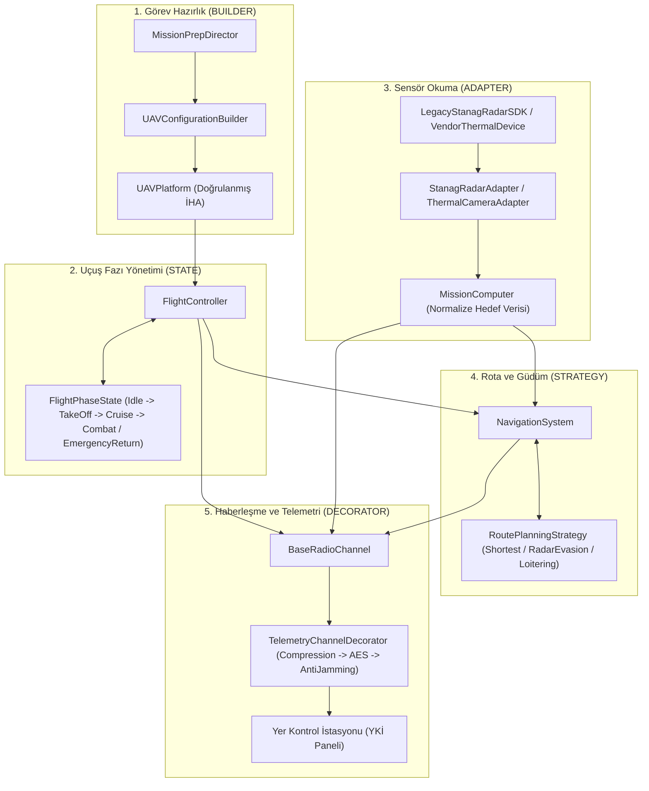
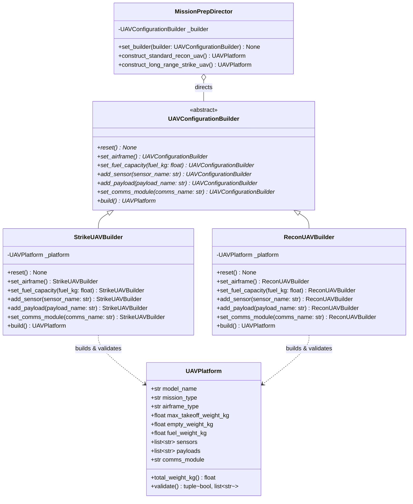
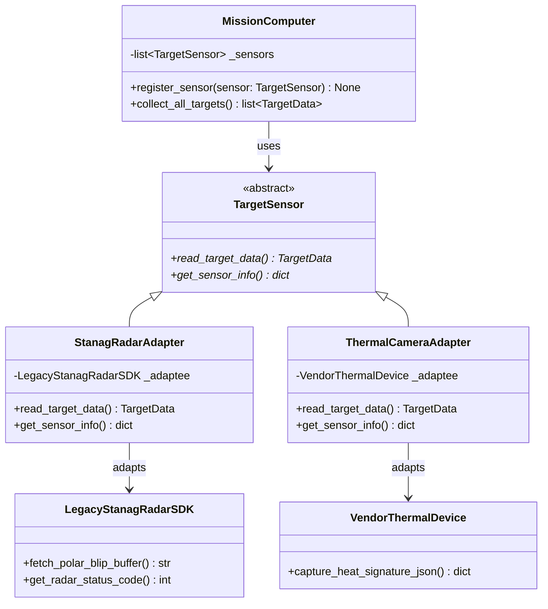
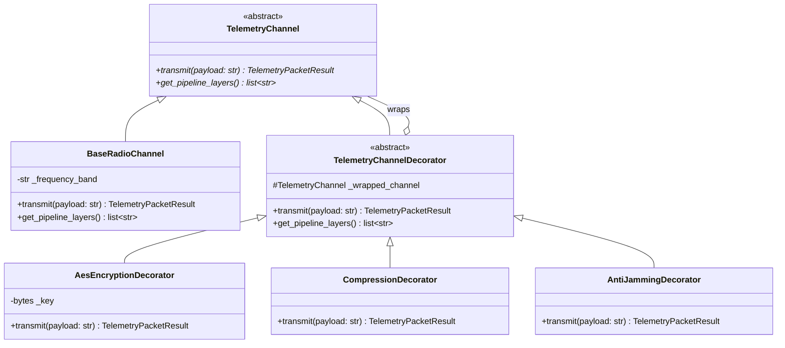
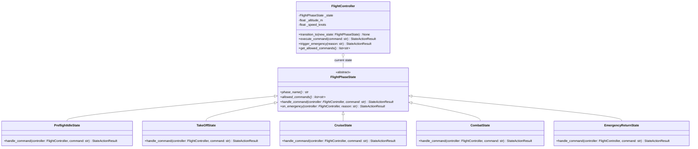
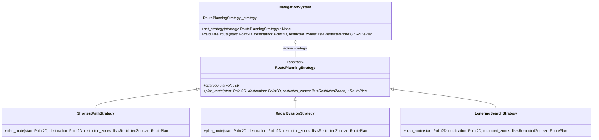

# İHA Görev ve Uçuş Kontrol Yazılımı — Mimari Analiz ve UML Sınıf Diyagramları

> **Proje Kapsamı Notu:** Bu yazılım tamamen eğitim, yazılım mimarisi ve nesne yönelimli tasarım kalıpları (GoF) simülasyonu amaçlıdır. Gerçek uçuş kontrol donanımı, gerçek sensör bağlantısı, elektronik harp veya fiziksel silah sistemi içermez; tüm veriler sentetiktir.

---

## 1. Gereksinim Belgesi (`project_requirements.pdf`) Analizi

Proje gereksinim belgesinde savunma ve havacılık simülasyonu bağlamında beş temel yazılım tasarım problemi tanımlanmış ve her biri için bir **Gang of Four (GoF)** tasarım kalıbı eşleştirilmiştir:

| # | Problem Tanımı | GoF Grubu & Kalıp | Katılımcı Roller ve Zorunlu Sınıflar | Çözülen Mimari Sorun |
|---|---|---|---|---|
| **1** | **Karmaşık Nesne İnşası ve Doğrulama:** Görev profiline göre faydalı yük, temsili mühimmat/ekipman, yakıt ve haberleşme modüllerinin maksimum kalkış ağırlığı (MTOW) ve istasyon uyumluluk kısıtlarıyla doğrulanarak oluşturulması. | **Yaratımsal (Creational)** **Builder** | - **Builder (ABC):** `UAVConfigurationBuilder` - **ConcreteBuilder:** `StrikeUAVBuilder`, `ReconUAVBuilder` - **Director:** `MissionPrepDirector` - **Product:** `UAVPlatform` | Telescoping constructor (çok parametreli kurucu) karmaşasını önler; adım adım inşa ve son aşamada tutarlılık/ağırlık doğrulaması sağlar. |
| **2** | **Heterojen Sensör Entegrasyonu:** Farklı üreticilere ve protokollere ait (eski nesil STANAG radar SDK'sı ve harici termal kamera cihazı) sensörlerin farklı metot imzaları ve veri çıktılarının tek bir standart hedef verisi formatına dönüştürülmesi. | **Yapısal (Structural)** **Adapter** | - **Target (ABC):** `TargetSensor` - **Adapter:** `StanagRadarAdapter`, `ThermalCameraAdapter` - **Adaptee:** `LegacyStanagRadarSDK`, `VendorThermalDevice` - **Client:** `MissionComputer` | `MissionComputer` kodunu değiştirmeden (Open/Closed) ve `isinstance` kontrollerine başvurmadan yeni/uyumsuz sensörleri sisteme entegre eder. |
| **3** | **Dinamik Haberleşme Güvenliği:** YKİ ile İHA arasındaki telemetri paketlerine çalışma zamanında şifreleme (AES), sıkıştırma ve hata düzeltme/parazit koruma (CRC/FEC simülasyonu) katmanlarının istenilen sıra ve kombinasyonla eklenip çıkarılması. | **Yapısal (Structural)** **Decorator** | - **Component (ABC):** `TelemetryChannel` - **ConcreteComponent:** `BaseRadioChannel` - **Decorator (ABC):** `TelemetryChannelDecorator` - **ConcreteDecorator:** `AesEncryptionDecorator`, `CompressionDecorator`, `AntiJammingDecorator` | Kalıtım ile $2^3 = 8$ farklı alt sınıf oluşmasını (sınıf patlaması) engeller; çalışma zamanında nesne sarmalama (wrapping) zinciri kurar. |
| **4** | **Uçuş Fazına Bağlı Davranış Değişimi:** Yerde Bekleme, Kalkış, Seyir, Görev/Angajman ve Acil Eve Dönüş (Failsafe) fazlarında irtifa kontrolü, motor tepkisi ve geçerli komutların tamamen değişmesi. | **Davranışsal (Behavioral)** **State** | - **Context:** `FlightController` - **State (ABC):** `FlightPhaseState` - **ConcreteState:** `PreflightIdleState`, `TakeOffState`, `CruiseState`, `CombatState`, `EmergencyReturnState` | `FlightController` içindeki devasa `if-elif-else` bloklarını ortadan kaldırır; her uçuş fazının kurallarını kendi sınıfında kapsüller. |
| **5** | **Değişken Güdüm ve Rota Algoritmaları:** Uçuş sırasında kısıtlı bölge tehdidi veya yakıt durumuna göre En Kısa Rota, Kısıtlı Bölgeden Kaçınma ve Bölge Tarama (Loitering) algoritmaları arasında çalışma zamanında geçiş yapılması. | **Davranışsal (Behavioral)** **Strategy** | - **Context:** `NavigationSystem` - **Strategy (ABC):** `RoutePlanningStrategy` - **ConcreteStrategy:** `ShortestPathStrategy`, `RadarEvasionStrategy`, `LoiteringSearchStrategy` | Rota hesaplama algoritmalarını `NavigationSystem`'den soyutlar; çalışma zamanında dinamik algoritma değişimi ve yeni strateji ekleme kolaylığı sağlar. |

---

## 2. Yazılım Mimarisi Değerlendirmesi ve SOLID Prensipleri

Uygulama, **İş Mantığı (Core Domain & Patterns)** ile **Sunum Katmanı (Streamlit UI)** birbirinden tamamen bağımsız olacak şekilde katmanlı mimariyle tasarlanmıştır:

1. **`src/models/`**: Kalıplar arasında taşınan değiştirilemez veya tip güvenli veri yapıları (`dataclass` tabanlı telemetri paketleri, koordinatlar, sensör okumaları, bileşen modelleri).
2. **`src/patterns/`**: Beş GoF tasarım kalıbının birbirinden izole alt paketleri (`builder`, `adapter`, `decorator`, `state`, `strategy`). Hiçbir kalıp sınıfı `streamlit` veya `plotly` kütüphanesine bağımlı değildir.
3. **`src/simulation/` & `src/services/`**: Beş kalıbı uçtan uca bir görev senaryosunda birleştiren orkestrasyon katmanı.
4. **`src/utils/`**: Merkezi olay günlüğü (`MissionEventLogger`) ve yardımcı doğrulama araçları.
5. **`ui/`**: Yalnızca `src/` altındaki servis ve kalıp arayüzlerini çağıran, Plotly grafiklerini ve kullanıcı etkileşimlerini çizen Streamlit bileşenleri.

### Mimari Prensiplerin Karşılanması
- **Single Responsibility Principle (SRP):** Her uçuş fazı, her rota stratejisi, her telemetri katmanı ve her sensör adaptörü yalnızca tek bir sorumluluğa sahiptir.
- **Open/Closed Principle (OCP):** Yeni bir sensör (`TargetSensor`), yeni bir rota algoritması (`RoutePlanningStrategy`), yeni bir telemetri katmanı (`TelemetryChannelDecorator`) veya yeni bir İHA tipi (`UAVConfigurationBuilder`) eklendiğinde mevcut istemci sınıflar (`MissionComputer`, `NavigationSystem`, `FlightController`) değiştirilmez.
- **Dependency Inversion Principle (DIP):** Üst seviye modüller (`MissionComputer`, `NavigationSystem`, `FlightController`, `MissionPrepDirector`) somut sınıflara değil, `ABC` ile tanımlanmış soyut arayüzlere bağımlıdır.
- **Composition over Inheritance:** Kalıtım patlaması yerine nesne kompozisyonu (`Decorator` sarmalama zinciri, `Strategy` enjeksiyonu, `State` referansı, `Adapter` sarmalaması) kullanılır.

---

## 3. Beş Tasarım Kalıbı Arasındaki İlişkiler ve Görev Akışı

Beş tasarım kalıbı tek başına çalışabildiği gibi, bir İHA görev yaşam döngüsünde birbirini tamamlayan bir boru hattı (pipeline) oluşturur:

1. **Builder -> State & Strategy:** `UAVConfigurationBuilder` ile inşa edilen `UAVPlatform`, sahip olduğu sensör/yük kapasitesi ve maksimum yakıt/ağırlık değerleriyle `FlightController` ve `NavigationSystem` için başlangıç platform parametrelerini sağlar.
2. **Adapter -> Strategy & State:** `MissionComputer`, `TargetSensor` adaptörleri üzerinden normalize edilmiş çevresel hedef/tehdid verilerini okur. Bir kısıtlı bölge veya anomali algılandığında `NavigationSystem` çalışma zamanında `RadarEvasionStrategy`'ye geçebilir veya kritik durumda `FlightController` `EmergencyReturnState` fazını tetikleyebilir.
3. **State & Strategy -> Decorator:** `FlightController`'ın aktif uçuş fazı (`FlightPhaseState`) ve `NavigationSystem`'in ürettiği aktif rota/konum bilgileri bir telemetri mesajına dönüştürülür ve `TelemetryChannel` dekoratör zincirinden (`CompressionDecorator` -> `AesEncryptionDecorator` -> `AntiJammingDecorator`) geçirilerek Yer Kontrol İstasyonu'na iletilir.

---

## 4. UML Sınıf Diyagramı Taslakları

### 4.1. Builder Kalıbı (Yaratımsal)

---

### 4.2. Adapter Kalıbı (Yapısal)

---

### 4.3. Decorator Kalıbı (Yapısal)

---

### 4.4. State Kalıbı (Davranışsal)

---

### 4.5. Strategy Kalıbı (Davranışsal)

---

## 5. Mantıklı Geliştirme Sırası (Yol Haritası)

1. **Aşama 1 — Proje Analizi ve Mimari (Tamamlandı):** Gereksinim analizi, klasör yapısı, UML diyagramları, merkezi log altyapısı, minimal uygulama iskeleti ve duman testleri.
2. **Aşama 2 — Builder Kalıbı:** İHA platformu (`UAVPlatform`) veri modeli, `UAVConfigurationBuilder`, `StrikeUAVBuilder`, `ReconUAVBuilder`, `MissionPrepDirector`, ağırlık/uyumluluk doğrulamaları ve birim testleri. (Diğer modüllerin ihtiyaç duyduğu İHA nesnesini ürettiği için ilk sırada geliştirilir.)
3. **Aşama 3 — Adapter Kalıbı:** Sentetik sensörler (`LegacyStanagRadarSDK`, `VendorThermalDevice`), adaptörler (`StanagRadarAdapter`, `ThermalCameraAdapter`), `TargetSensor` arayüzü ve `MissionComputer` entegrasyonu + birim testleri.
4. **Aşama 4 — Decorator Kalıbı:** `TelemetryChannel`, `BaseRadioChannel`, `TelemetryChannelDecorator` ve `AesEncryptionDecorator` (Fernet/AES kütüphanesi ile dinamik anahtarlı), `CompressionDecorator` (zlib + base64), `AntiJammingDecorator` (temsili CRC/FEC paket koruma simülasyonu) + birim testleri.
5. **Aşama 5 — State Kalıbı:** `FlightController`, `FlightPhaseState` ve 5 uçuş fazı (`PreflightIdleState`, `TakeOffState`, `CruiseState`, `CombatState`, `EmergencyReturnState`) geçiş kuralları, geçersiz komut reddi ve acil durum (Failsafe) davranışları + birim testleri.
6. **Aşama 6 — Strategy Kalıbı:** 2B sentetik koordinat/kısıtlı bölge modelleri, `NavigationSystem`, `RoutePlanningStrategy` ve 3 algoritma (`ShortestPathStrategy`, `RadarEvasionStrategy`, `LoiteringSearchStrategy`) + rota karşılaştırma metrikleri ve birim testleri.
7. **Aşama 7 — Görsel Arayüz (Streamlit + Plotly):** Modern koyu temalı simülasyon kontrol paneli (7 ekran: Dashboard, UAV Configuration, Sensor Integration, Telemetry System, Flight Controller, Navigation, Design Patterns).
8. **Aşama 8 — Test ve Dokümantasyon:** Uçtan uca entegrasyon testleri, son dokümantasyon güncellemeleri ve sistem doğrulaması.
